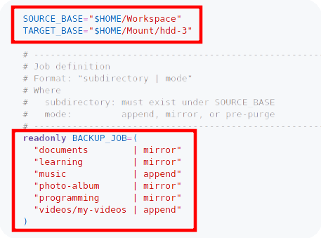

## 🐧 Backup & Restore Tool


#### ⭐⭐ Like this project? Support my work by giving it a star on [GitHub](https://github.com/zappee/backup-and-restore-tool) ⭐⭐


### 1) Overview
A simple, secure, and interactive file copy and backup tool to back up and restore files especially for laptops.
If you use external USB hard drives or flash drives to back up your personal files, documents, and photos, this tool makes the process effortless.
It is specifically built for people who need to manage backups of multiple different laptops or computers and keep the files synced between the laptops.

It handles adding, deleting, and renaming files and directories seamlessly.
It also works perfectly when tracking changes to file properties, such as modification timestamps, ownership, permissions, and system flags.

Unlike other automated tools that run silently in the background, this tool uses a two-step confirmation process.
It shows you a "preview" of exactly what files will be copied, changed, or deleted before it actually modifies anything on your disks, giving you complete control and peace of mind.

### 2) Why Use This Tool?
* **Safe execution:** Automatically runs a dry-run first to visualize differences (additions, modifications, deletions) before executing the actual sync.
* **Smart disk space management:** The tool offers three ways to handle your backups: `append`, `mirror`, and `pre-purge`.
* **Output explainer:** Embedded documentation within the script breaks down complex rsync shortcodes.
* **Built for multiple computers:** You can easily create custom backup and/or restore configuration scripts for your work laptop, personal laptop, or family computers, keeping all your backup routines organized in one place.
* **Visual progress:** Displays clear progress bars and file sizes while copying so you never have to guess if the backup is frozen.
* **Flexible sync job configuration:** Setting up or updating your backup jobs is effortless—just point to your `SOURCE` and `TARGET` folders and list the subfolders you want to include.

  

### 3) What's inside the box?
* `sync-lib.sh`: The core execution engine containing script arguments validation, double-prompt safeguards, and the main rsync orchestration logic. You don't need to change this file.
* `sync-to-hdd2.sh`: A job configuration illustrating how to back up local folders to your external hard drive.
* `sync-from-hdd2.sh`: A corresponding job profile showing how to quickly reverse the flow to copy your files back (restore) from your external drive to your laptop (perfect for setting up a new computer or recovering from a crash).

### 4) Prerequisites
* Ensure you are using a Unix-like environment with `rsync` installed.
* Check if rsync is available: `rsync --version`

### 5) Backup your files and Directories
Before running your first backup, it is best to organize your files cleanly on your computer so the process works smoothly and effortlessly.
The easiest approach is to keep all your personal files in one main parent folder.
Scattering files across different locations on your system makes backing up, restoring, and verifying your data much harder to manage.
Here is a recommended folder structure:

```console
└── Workspace
    ├── documents
    ├── finance
    ├── holiday
    ├── learning
    ├── music
    ├── photo-album
    ├── temp
    ├── videos
    ├── ...
    └── work
```

When configuring your backup, you can pick and choose which subfolders to include, or completely skip unimportant ones, like the `temp` folder above.

**Create a Backup Job Script**

Once your folders are organized, create a job script to define what gets backed up.
A good naming convention for your automated backup sctipt is `sync-to-<portable-disk-label>.sh`.
Where `<portable-disk-label>` is the label of your external or portable disk.

Use [sync-to-portable-2.sh](bin/sync-to-portable-2.sh) as a template to create your own automated backup script.
Below is an example setup that matches the folder structure above, you only need to update the `SOURCE_BASE`, `TARGET_BASE`, and `JOB` variables:

```console
SCRIPT_HOME="$(cd "$(dirname "${BASH_SOURCE[0]}")" && pwd)"
source "${SCRIPT_HOME}/lib/sync-lib.sh"

SOURCE_BASE="$HOME/Workspace"
TARGET_BASE="$HOME/Mount/portable-2"

readonly JOB=(
  "documents        | mirror"
  "finance          | mirror"
  "holiday          | mirror"
  "music            | append"
  "photo-album      | mirror"
  "videos/series    | append"
  "videos/my-videos | mirror"
  "work             | mirror"
)

run_job "$SOURCE_BASE" "$TARGET_BASE" "${JOB[@]}"
```

**Configuration Options:**
* **SOURCE_BASE**: The main folder containing the files and subfolders you want to back up.
* **TARGET_BASE**: The destination drive or folder where your backups will be stored.
* **JOB**: A list of subfolders paired with their sync mode.

In the example above, `documents` uses `mirror` mode, while `music` and `videos/series` use `append` mode.
If you want to keep things simple and just maintain an exact copy of your computer on your external drive, stick with `mirror` for everything.

**Available Sync Modes:**
* **append:** Copies new and modified files from source to target, leaving deleted or older files untouched on the backup drive.
* **mirror:** Keeps the target identical to the source by deleting obsolete files on the fly during the transfer. Best when the backup disk has plenty of free space.
* **pre-purge:** A space-saving exact mirror. Scans and deletes all obsolete files from the target first before copying new data. Use this when your backup drive is low on free space so removed files make room before new ones arrive.

### 6) Restore files from a backup


### 6) How to use it
Instead of passing arguments manually every time, you can maintain clean profiles for your personal devices using wrapper files like the provided templates.

#### 6.1) Configure a machine to back up
Copy the backup template file (`sync-task-backup-hp.sh`) to customize it for your specific machine (`sync-task-backup-hp-spectre.sh`) and edit your paths:

```console
SOURCE_HOME=/home/$USER/Workspace
TARGET_HOME=/media/$USER/USB-Disk/hdd-1
```

Specify the directories you would like to back up:
```console
do_backup "1/3" projects delete-during
do_backup "2/3" documents delete-during
do_backup "3/3" software-installers keep
```

#### 6.2) Configure a machine to restore
Copy the restore template file (`sync-task-restore-hp.sh`) to customize it for your specific machine (`sync-task-restore-hp-spectre.sh`) and reverse your paths:

```console
SOURCE_HOME=/media/$USER/USB-Disk/hdd-1
TARGET_HOME=/home/$USER/Workspace

do_backup "1/2" projects delete-during
do_backup "2/2" documents delete-during
```

### 7) How it works
When you start a backup or recovery job, the tool stops and asks for your input twice to protect your data from accidental loss:

1.**Dry-run analysis:** The script simulates the task without altering data.
2. **First prompt:** It displays the raw upcoming changes and pauses:
   `Comparing the SOURCE and TARGET directories and show the difference. Continue? [y/n]`
3. **Second prompt:** If you approve, it flashes a final warning before writing files to the destination medium:
   `Do you want to copy files from SOURCE to TARGET?`
   `Files on TARGET media will be overwritten!`
   `Continue [y/n]`

### 8) Understanding `rsync` outputs
When the comparison table scrolls past during Step 1, you can read the structural shortcodes (`YXcstpoguax`) using this reference pattern:

* **First character (`Y`):** The action type, e.g., `>` file received, `<` file sent, `c` local creation, `.` metadata-only change.
* **Second character (`X`):** The item type, `f` for file, `d` for directory, `L` for symlink.
* **Attributes (`cstpoguax`):** Identifies property updates where `s` indicates a modified file size, `t` flags a timestamp update, and `p` warns of permission variations.

### 9) Source code

[https://github.com/zappee/file-backup-restore](https://github.com/zappee/file-backup-restore)

### 🤝 Contributing

Contributions, feature requests, optimization, and bug reports are always welcome!
For more information, please visit my [homepage](https://zappee.github.io).
